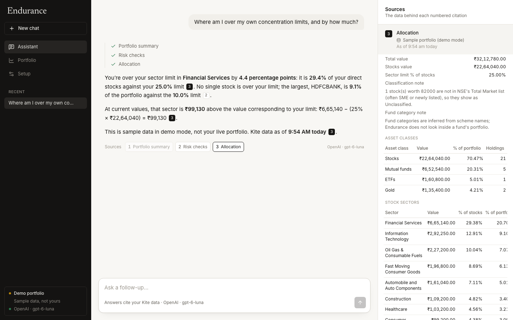
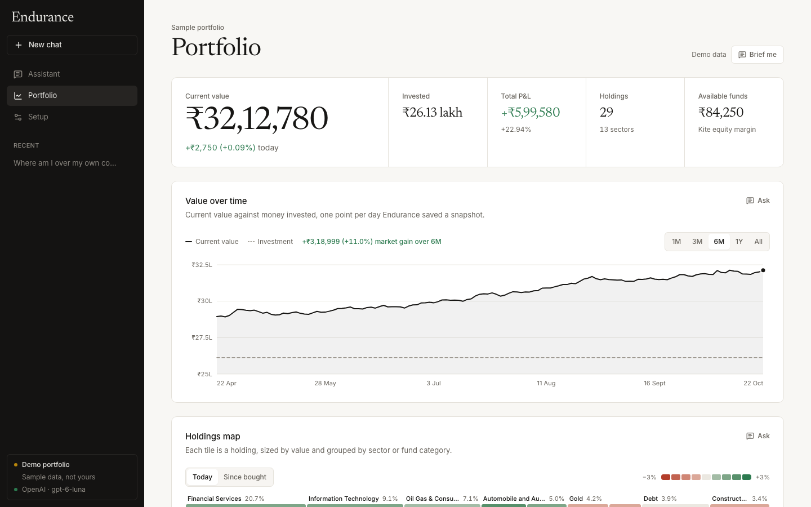

# Endurance

> Ask questions about your Zerodha portfolio. Every answer cites the data it used.




Endurance runs on your own computer. You give it your own Kite Connect app and your own AI key in a `.env` file, log in to Kite once a day, and then ask things like:

- *What pulled my portfolio down today?*
- *Where am I over my own concentration limits, and by how much?*
- *What happens to my portfolio if HDFCBANK falls 20%?*
- *Which holdings are below my buy price?*

The assistant reads your holdings, mutual funds and positions through a fixed set of read-only tools. Every figure in an answer carries a numbered citation, and the **Sources** panel shows the exact data behind it. It doesn't predict prices or tell you what to buy or sell.

A **Portfolio** page has the charts: value over time, a holdings map coloured by today's move, asset mix, NSE sectors against your limit, risk checks, a risk map, today's movers and a sortable holdings table.

## Quick start

You need [Node.js 22+](https://nodejs.org), a Zerodha account, and an API key from OpenAI, Anthropic, Google or any OpenAI-compatible service.

```bash
git clone https://github.com/yesabhishek/endurance.git
cd endurance
cp .env.example .env      # then fill in your keys (below)
npm install
npm run dev               # open http://localhost:3000
```

Then click **Log in to Kite**. Your portfolio loads straight after.

**Just want to look around first?** `npm run demo` starts it with a made-up portfolio. Only the AI key is needed.

### 1. Create a Kite Connect app

1. Sign in at [developers.kite.trade](https://developers.kite.trade/apps) and create an app. The free **Personal** plan covers holdings, funds and positions.
2. Set the app's **Redirect URL** to `http://localhost:3000/api/kite/callback`.
3. Copy the app's **API key** and **API secret** into `.env`:

```bash
KITE_API_KEY=your_api_key
KITE_API_SECRET=your_api_secret
```

Zerodha ends every Kite session early each morning, so you log in again each day. Until then Endurance keeps showing (and answering from) your last snapshot, and says so.

### 2. Add one AI key

| Provider | Put this in `.env` | Default model |
| --- | --- | --- |
| OpenAI | `OPENAI_API_KEY` | `gpt-5.5` |
| Anthropic | `ANTHROPIC_API_KEY` | `claude-sonnet-5-5` |
| Google Gemini | `GOOGLE_GENERATIVE_AI_API_KEY` | set `AI_MODEL` |
| Vercel AI Gateway | `AI_GATEWAY_API_KEY` | set `AI_MODEL`, e.g. `anthropic/claude-sonnet-5-5` |
| OpenRouter, Groq, Ollama, LM Studio… | `OPENAI_BASE_URL` (+ `OPENAI_API_KEY` if needed) | set `AI_MODEL` |

Set `AI_MODEL` to use a different model. With several keys, `AI_PROVIDER` picks one. The **Setup** page shows exactly what Endurance found and what's missing.

### Or run it with Docker

```bash
cp .env.example .env      # fill in your keys
docker compose up         # builds once, then open http://localhost:3000
```

## How answers stay grounded

- **Data first.** The model must call a data tool before it writes anything, and it gets fresh data for every question.
- **Citations.** Each tool result has a reference (S1, S2…). The model is told to cite every figure, and the app turns those references into chips that open the source data. A citation that doesn't match any data the model read is flagged in red.
- **Arithmetic, not forecasts.** "What if" questions go through a calculator tool that applies the move to today's holdings and labels the result as arithmetic. There is no price prediction anywhere in the app.
- **No advice.** Asked whether to sell, it lays out what the data shows and the trade-offs, and leaves the decision to you.
- **Honest gaps.** Stale snapshots, unclassified stocks, mutual funds having no daily change, and short history all come back as caveats the answer has to pass on.

The tools are in [`src/lib/ai/tools.ts`](src/lib/ai/tools.ts) and the rules in [`src/lib/ai/prompt.ts`](src/lib/ai/prompt.ts).



## Privacy

- **Read-only.** Endurance never calls Kite's order endpoints. It can't place, change or cancel orders.
- **Local.** Today's Kite session, daily snapshots and your chats are JSON files in `.data/`. Delete the folder to start fresh.
- **What leaves your machine:** read-only calls to Zerodha; the portfolio figures the assistant looks up, sent to your AI provider with your key; and a weekly download of NSE's public index lists to label sectors.
- **No sign-in, loopback only.** The app listens on `127.0.0.1`, blocks cross-site requests, and sets a strict CSP. Don't expose it to the internet. See [SECURITY.md](SECURITY.md).

## Configuration

Everything lives in `.env` (see [`.env.example`](.env.example)). Restart after changing it.

| Variable | What it does |
| --- | --- |
| `KITE_API_KEY`, `KITE_API_SECRET` | Your Kite Connect app |
| `OPENAI_API_KEY`, `ANTHROPIC_API_KEY`, `GOOGLE_GENERATIVE_AI_API_KEY`, `AI_GATEWAY_API_KEY` | Your AI key (one is enough) |
| `AI_PROVIDER`, `AI_MODEL`, `OPENAI_BASE_URL` | Choose the provider, model, or an OpenAI-compatible server |
| `APP_URL` | Where you open the app (default `http://localhost:3000`). Kite's redirect URL is this plus `/api/kite/callback` |
| `LIMIT_STOCK_PCT`, `LIMIT_SECTOR_PCT` | Your concentration limits (default 10% per stock, 25% per sector) |
| `DATA_DIR` | Where local data is kept (default `.data`) |
| `ALLOWED_HOSTS` | Extra host names, only if you put Endurance behind your own proxy |

## Troubleshooting

- **"Kite rejected the login"**: the secret doesn't match the app, or the app's redirect URL isn't exactly `APP_URL/api/kite/callback`.
- **Using a port other than 3000**: set `APP_URL` to match (for example `http://localhost:4000`) and update the Kite redirect URL.
- **"That Kite login didn't start from this browser"**: start the login from the app again; the check expires after 10 minutes.
- **The value chart is empty**: Kite's free API has no past portfolio values, so Endurance saves one snapshot a day while you're logged in. The chart appears from the second day.
- **A stock shows as Unclassified**: it isn't in NSE's Total Market list (often SME or newly listed shares).

## Development

```bash
npm test            # unit tests
npm run lint
npm run typecheck
npm run build
```

```
src/
├── app/                 pages (assistant, conversation, portfolio, setup) and API routes
├── components/chat/     chat view, composer, citations and sources panel, safe markdown
├── components/portfolio charts and tables (plain SVG, no chart library)
├── lib/ai/              provider from .env, read-only tools, grounding prompt
├── lib/kite/            read-only Kite Connect client, login session, sync
├── lib/portfolio.ts     allocation, concentration and limit checks
├── lib/risk.ts          the five risk checks shared by the charts and the assistant
├── lib/data.ts          snapshot cache and daily history
└── proxy.ts             host allowlist, cross-site write blocking, CSP
```

## License

MIT. See [LICENSE](LICENSE).

---

Endurance is an independent project, not affiliated with or endorsed by Zerodha. It explains your own data and does not provide investment advice.
