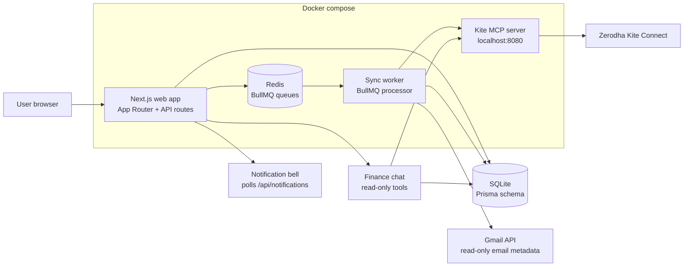

# Endurance

> A minimalist private finance workspace for expenses, investments, and read-only financial analysis.


Endurance is a local-first personal finance app. It ingests financial emails from Gmail, syncs investments through the Zerodha Kite MCP server, and exposes a read-only finance chat interface for technical expense, portfolio, and risk questions.

## Features

- **Expense Tracking** — Gmail OAuth read-only sync for card bills, Google Pay/UPI, subscriptions, bills, broker statements, MFs, and gold emails.
- **Investment Sync** — Read-only Kite MCP integration for holdings, positions, margins, profile, quotes, and mutual fund holdings.
- **Async Sync Queue** — BullMQ and Redis keep Gmail and Kite updates outside request/response paths.
- **In-App Notifications** — A notification bell tracks queued, running, completed, and failed sync activity.
- **Finance Chat** — `@expenses`, `@investments`, `@emails`, `@portfolio`, and `@market` questions using Vercel AI SDK with a strict read-only tool allowlist.
- **Financial UX** — Interactive expense analytics, searchable/sortable tables, inferred credit cards, portfolio allocation, and holding impact views.
- **Local SQLite** — Prisma Client models for normalized financial records and encrypted OAuth tokens.

## Quick Start

### Prerequisites

- Node.js 22+ for local web development
- Docker and Docker Compose for full stack local runtime
- Zerodha Kite Connect credentials for the local Kite MCP server
- Google OAuth credentials for Gmail ingestion

### Setup

1. **Clone the repository**
   ```bash
   git clone https://github.com/yesabhishek/endurance.git
   cd endurance
   ```

2. **Configure environment variables**
   ```bash
   cp .env.example .env
   ```
   
   Edit `.env` with your credentials:
   ```env
   KITE_API_KEY=your_kite_api_key
   KITE_API_SECRET=your_kite_api_secret
   APP_ENCRYPTION_KEY=replace-with-a-long-random-local-secret
   GOOGLE_CLIENT_ID=your_google_oauth_client_id
   GOOGLE_CLIENT_SECRET=your_google_oauth_client_secret
   ```

3. **Start the application**
   ```bash
   docker compose up --build
   ```

4. **Open in browser**
   
   Visit [http://localhost:3000](http://localhost:3000).

## Project Structure

```
endurance/
├── web/                    # Next.js App Router app and worker
│   ├── src/app/            # Routes and API handlers
│   ├── src/components/     # shadcn/ui and app components
│   ├── src/lib/            # Gmail, Kite, finance, DB libraries
│   ├── prisma/             # Prisma schema
│   └── scripts/init-db.mjs # SQLite initializer
├── kite-mcp/               # Kite MCP Server (Go)
├── .env.example            # Environment template
└── README.md
```

## Architecture

Endurance runs as a local-first Docker stack. The web app handles UI, OAuth callbacks, queueing, notifications, and read-only chat. A separate worker consumes sync jobs so long-running Gmail and Kite updates do not block page requests. SQLite remains the durable local store, while Redis is only the BullMQ job backend.



### Data Flow

1. The user connects **Spending Data** through Gmail OAuth or **Investment Data** through Zerodha/Kite.
2. Sync buttons create a `SyncRun` and enqueue a BullMQ job immediately.
3. The worker claims the job, reads from Gmail or Kite MCP, normalizes records, and writes to SQLite.
4. Gmail sync uses a durable cursor so later syncs process only new email history or timestamp-overlap fallbacks.
5. Completion or failure writes an in-app notification, which appears in the top-bar notification bell.
6. Dashboard, expenses, investments, and chat read from local normalized data.

### Main Components

| Component | Responsibility |
|-----------|----------------|
| `web/src/app` | Next.js pages and API routes |
| `web/src/lib/gmail` | Gmail OAuth, incremental sync, parsing pipeline |
| `web/src/lib/kite` | Kite MCP client and investment sync |
| `web/src/lib/sync` | BullMQ queue, job enqueueing, worker orchestration |
| `web/src/lib/finance` | Repository queries, analytics, credit-card detection, data shaping |
| `web/prisma/schema.prisma` | SQLite data model for accounts, sync runs, cursors, notifications, transactions, holdings |
| `kite-mcp` | Go MCP server wrapping Zerodha Kite Connect |

## Configuration

### Required Environment Variables

| Variable | Description |
|----------|-------------|
| `KITE_API_KEY` | Kite Connect API key for the MCP server |
| `KITE_API_SECRET` | Kite Connect API secret for the MCP server |
| `APP_ENCRYPTION_KEY` | Local encryption key for OAuth tokens |

### Optional Environment Variables

| Variable | Description |
|----------|-------------|
| `GOOGLE_CLIENT_ID` | Google OAuth client ID |
| `GOOGLE_CLIENT_SECRET` | Google OAuth client secret |
| `GOOGLE_REDIRECT_URI` | Usually `http://localhost:3000/api/gmail/callback` |
| `GMAIL_SYNC_MONTHS` | Spending Data backfill window, defaults to `48` |
| `GMAIL_SYNC_LIMIT` | Gmail fetch cap for backfill and fallback scans |
| `AI_GATEWAY_API_KEY` | Optional Vercel AI Gateway key |
| `AI_MODEL` | Optional AI model, defaults to `openai/gpt-5.4` |

## Pages

| Route | Description |
|-------|-------------|
| `/` | Financial overview |
| `/expenses` | Expense analytics, searchable transactions, subscriptions, inferred credit cards |
| `/investments` | Portfolio analytics, asset allocation, searchable holdings |
| `/chat` | Read-only finance chat |
| `/settings` | Gmail/Kite sync and local data controls |

## Security

This project takes security seriously:

- **No hardcoded credentials** — All secrets are loaded from environment variables
- **`.env` is gitignored** — Your credentials are never committed
- **Encrypted OAuth tokens** — Gmail tokens are encrypted locally with `APP_ENCRYPTION_KEY`
- **Normalized email storage** — The app stores source IDs, headers, snippets, parsed amounts, and metadata; it does not persist raw email bodies
- **Read-only finance tools** — Chat can query local records and read-only Kite MCP tools only

### Important Security Notes

1. **Never commit `.env`** — The `.gitignore` file excludes it
2. **Rotate your API keys** if you accidentally expose them
3. **Use a long random `APP_ENCRYPTION_KEY`** before connecting Gmail

## Development

### Running web locally without Docker

```bash
cd web
cp .env.example .env
npm install
npm run db:generate
npm run db:init
npm run dev
```

### Running tests

```bash
cd web
npm test
npm run lint
npm run build
```

### CI

GitHub Actions runs on pushes to `main`, pushes to `codex/**` branches, and pull requests:

- Web: `npm ci`, `npm test`, `npm run lint`, `npm run build`
- Kite MCP: `go test ./...`

## API Endpoints

| Endpoint | Method | Description |
|----------|--------|-------------|
| `/api/gmail/connect` | GET | Start Gmail OAuth |
| `/api/gmail/callback` | GET | Complete Gmail OAuth |
| `/api/sync/gmail` | POST | Enqueue Spending Data sync |
| `/api/sync/kite` | POST | Enqueue Investment Data sync |
| `/api/notifications` | GET | Read recent sync notifications |
| `/api/notifications/read` | POST | Mark one or all notifications as read |
| `/api/chat` | POST | Stream read-only finance analysis |

## License

MIT License — see [LICENSE](LICENSE) for details.

## Acknowledgments

- [Zerodha Kite Connect](https://kite.trade/) and Kite MCP
- [Google Gmail API](https://developers.google.com/gmail/api)
- [Vercel AI SDK](https://ai-sdk.dev/docs)
- [shadcn/ui](https://ui.shadcn.com)

---

**Disclaimer**: This is a personal finance tracker for informational purposes only. It does not provide investment advice. Always do your own research before making investment decisions.
