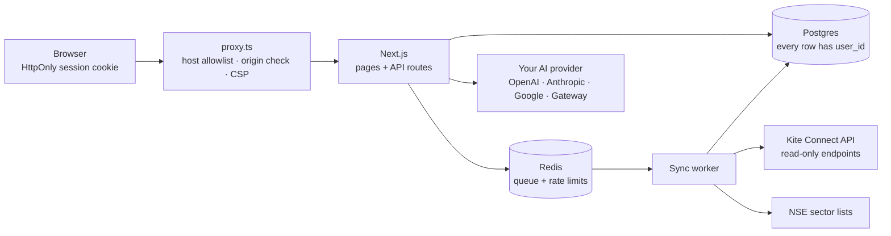

# Endurance

> Your Zerodha portfolio by sector, with a private analyst you can ask anything. Self-hosted, read-only, bring your own keys.


Endurance connects to **your own** Kite Connect app, syncs your holdings, mutual funds and positions, classifies every stock into its NSE sector, and shows how your money is spread: by sector, asset class and fund category, against limits you set. A chat assistant answers questions about your portfolio using **your own** OpenAI, Anthropic, Google or Vercel AI Gateway key.

The dashboard shows:

- **Value over time**: current value against money put in, from 1 month to all history.
- **Portfolio heatmap**: every holding sized by value, grouped by sector, coloured by today's move or return since purchase.
- **Risk zones**: five checks (largest stock and sector against your limits, top-5 share, effective number of holdings, money in losing positions), each marked comfortable, watch or high.
- **Risk map**: each stock by its share of your money against its return, with the concentration and below-cost zones shaded.
- **20-year outlook**: a seeded Monte Carlo fan chart with monthly SIP and step-up. Switch on **AI forecast** and your own model sets the return and volatility assumptions for your actual holdings; the math and the assumptions stay on screen.
- **Ask Endurance**: a chat panel docked beside every page (⌘K). Every chart has an Ask button that sends a question about what it shows.

- **Read-only.** Endurance never calls Kite's order endpoints. It cannot place, modify or cancel orders.
- **Your keys stay yours.** Kite and AI keys are entered in the app, encrypted at rest, and never sent to the browser.
- **Your data stays on your machine.** Everything lives in your own Postgres.

## Quick start

You need [Docker](https://docs.docker.com/get-docker/) and a Zerodha account.

```bash
git clone https://github.com/yesabhishek/endurance.git
cd endurance
./scripts/setup.sh          # writes .env with random secrets
docker compose up           # pulls the released images and starts everything
```

`docker compose up` uses the prebuilt images from [GitHub Container Registry](https://github.com/yesabhishek?tab=packages&repo_name=endurance) (`endurance-web`, `endurance-worker`, `endurance-migrate`, for Intel and ARM). To pin a version, set `ENDURANCE_VERSION=0.1.0` in `.env`. To run exactly the code you checked out, use `docker compose up --build`. To update later: `git pull && docker compose pull && docker compose up -d` (migrations run automatically).

Open **http://localhost:3000**, create your account, then go to **Settings**:

1. **Create a Kite Connect app** at [developers.kite.trade](https://developers.kite.trade/apps). The free *Personal* plan is enough for holdings and positions.
2. Set the app's **Redirect URL** to `http://localhost:3000/api/kite/callback` (Settings shows the exact value with a copy button).
3. Paste the app's **API key and secret** into Settings, then click **Log in to Kite**.
4. Add an **AI provider key** and pick a model. The key is verified by listing the models it can use.

Your portfolio syncs right after login. Kite ends every session early each morning (an exchange rule), so log in again each day to refresh prices; the dashboard keeps showing your last snapshot meanwhile.

## What you get

| Page | What it shows |
| --- | --- |
| Dashboard | Current value and day's P&L, value against investment over time, holdings heatmap, risk zones, risk map, allocation by asset class and sector, 20-year outlook with an AI forecast toggle, today's movers, largest holdings |
| Holdings | Every holding with sector and weight, concentration, value over time, open positions |
| Ask | Full-page chat with history. The same assistant is docked beside every page (⌘K), with source chips showing which data each answer used |
| Spending | Optional: expenses, subscriptions and cards parsed from Gmail (read-only) |
| Settings | Kite app and login, AI keys and model, your limits, Gmail, data reset |

Sectors come from NSE's index constituent lists (Nifty Total Market, about 750 companies), refreshed weekly by your own install. Mutual funds and ETFs are grouped by category.

## Architecture



- **Web** handles sign-in, settings, dashboards, the Kite login round trip and chat.
- **Worker** runs syncs from a BullMQ queue so slow API calls never block a page. Run more workers to sync more users in parallel.
- **Migrate** is a one-shot container that applies Prisma migrations before the app starts.

The web tier keeps no state in memory (sessions live in Postgres, rate limits in Redis), so you can run several copies behind a load balancer.

## Security model

| Threat | Protection |
| --- | --- |
| Someone else on your network opens the app | Accounts with scrypt-hashed passwords and server-side sessions; the app is published on `127.0.0.1` only by default |
| A website you visit sends requests to your local app (CSRF) | `proxy.ts` rejects cross-site writes by `Origin`/`Sec-Fetch-Site`; cookies are `SameSite=Lax` |
| DNS rebinding | Requests are refused unless the `Host` is loopback, `APP_URL` or listed in `ALLOWED_HOSTS` |
| Database leak exposes keys | Kite secrets, access tokens and AI keys are AES-256-GCM encrypted with a key derived from `APP_SECRET`, bound to the owning row; session ids are stored hashed |
| One user reading another's data | Every user-owned table has `userId`; app code reaches them only through `tenantDb(userId)`, which scopes every query and is unit-tested |
| Login CSRF on Kite or Google OAuth | Random `state` checked on callback; Google also uses PKCE |
| Prompt injection through broker or email text | Chat tools are read-only, bound to the signed-in user, return minimal fields, and the UI renders no links or images from model output |
| Brute force | Per-IP and per-account rate limits on sign-in |
| XSS and clickjacking | Strict nonce-based CSP, `frame-ancestors 'none'`, `nosniff`, HSTS on HTTPS |
| Leaked secrets in git | CI runs gitleaks on every push and pull request; only `*.example` env files are tracked |
| Vulnerable dependencies | CI fails on unreviewed high or critical advisories; Dependabot opens weekly updates |

See [SECURITY.md](SECURITY.md) for rotating `APP_SECRET` and reporting issues.

## Running on a server

1. Put Endurance behind HTTPS (Caddy, nginx or a tunnel) and set `APP_URL=https://your-domain`. Secure cookies, HSTS and `upgrade-insecure-requests` switch on automatically.
2. Set `TRUST_PROXY=true` if the proxy sets `X-Forwarded-For`, so rate limits see real client addresses.
3. Change the Kite app's redirect URL to `https://your-domain/api/kite/callback`.
4. Set `ALLOW_SIGNUP=true` only if other people should be able to create accounts. Each account must use its own Kite Connect app; Zerodha binds an app to one client ID unless it approves multi-user access.
5. Back up the `postgres-data` volume, and keep `APP_SECRET` somewhere safe. Without it, stored keys can't be decrypted.

## Development

```bash
./scripts/setup.sh
docker compose -f docker-compose.yml -f docker-compose.dev.yml up -d postgres redis
cd web
npm install
npm run db:migrate
npm run dev        # http://localhost:3000
npm run worker     # in a second terminal
```

Checks that CI runs: `npm run audit:prod`, `npm run typecheck`, `npm test`, `npm run lint`, `npm run build`, plus a migration drift check against a fresh Postgres and a gitleaks scan.

## Troubleshooting

- **"Kite rejected the login"**: the API secret doesn't match the app, or the redirect URL in the Kite console isn't exactly `APP_URL/api/kite/callback`.
- **"That Kite login didn't start from this browser session"**: start the login from Settings in the same browser; the state cookie expires after 10 minutes.
- **Prices didn't update this morning**: Kite sessions end daily. Click **Log in to Kite** on the dashboard.
- **"Unknown host"**: add the host name you use to `ALLOWED_HOSTS`.
- **Sector shows "Unclassified"**: the stock isn't in NSE's Total Market list (often SME or newly listed shares).

## Project structure

```
endurance/
├── web/                       Next.js app, worker, Prisma schema and migrations
│   ├── src/proxy.ts           request guard and security headers
│   ├── src/app/               pages and API routes
│   ├── src/lib/               auth, crypto, tenant db, Kite, AI, analytics
│   └── prisma/                schema.prisma and migrations
├── scripts/setup.sh           generates .env with random secrets
├── docker-compose.yml         postgres, redis, migrate, web, worker
├── docker-compose.dev.yml     publishes postgres and redis on 127.0.0.1 for local dev
└── kite-mcp/                  legacy Go MCP server, no longer used by the app
```

## License

MIT. See [LICENSE](LICENSE).

---

Endurance is an independent project, not affiliated with or endorsed by Zerodha. It shows analysis of your own data and does not provide investment advice.
